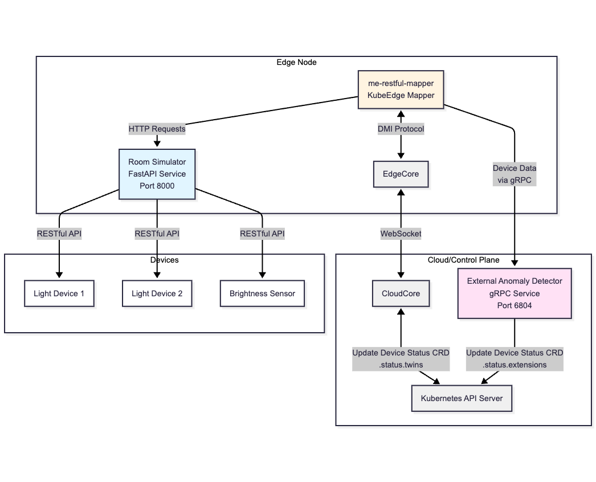

# Device Anomaly Detection Demo
PR [#6543](https://github.com/kubeedge/kubeedge/pull/6543) introduces device anomaly detection capabilities to KubeEdge. This project demonstrates an IoT device anomaly detection system using KubeEdge mapper framework, gRPC communication, and machine learning-based anomaly detection, and serves as a reference demonstration for developers to use features introduced in the PR.

## Project Structure

```
device-anomaly-detection-demo/
├── api/                              # Protocol definitions
│   └── external_anomaly_detector.proto
├── external-anomaly-detector/        # Anomaly detection service
│   ├── main.py
│   ├── pyproject.toml
│   ├── data/                         # Training and observation data
│   ├── externalanomalydetectorpb/    # Generated gRPC code (Python)
│   └── model_training/               # ML model training logic
├── me-restful-mapper/                # KubeEdge mapper application
│   ├── cmd/                          # Main entry point
│   ├── api/                          # Generated gRPC code (Go)
│   ├── data/                         # Database and streaming adapters
│   ├── device/                       # Device management logic
│   ├── devicecrds/                   # Kubernetes device CRDs
│   ├── driver/                       # Device driver implementations
│   ├── resource/                     # Kubernetes deployment resources
│   ├── build.sh                      # Build script
│   ├── config.yaml                   # Mapper configuration
│   └── Dockerfile_nostream           # Docker build file
├── room-simulator/                   # Room device simulator
│   ├── main.py
│   ├── pyproject.toml
│   └── README.md
└── generate_grpc_code.sh             # Script to generate gRPC code from proto
```

### Component Overview

#### `api/`
Contains the Protocol Buffer definition (`external_anomaly_detector.proto`) for gRPC communication between the mapper and the anomaly detection service.

#### `external-anomaly-detector/`
A Python-based gRPC service that receives device data from the mapper, stores it in memory, and performs anomaly detection using a machine learning model. The service:
- Collects device property updates via gRPC
- Trains a Bayesian Network model on historical observation data
- Detects anomalies by comparing actual vs. predicted device states
- Localizes the faulty device by systematically flipping reported light states and re-running inference
- Updates DeviceStatus CRD `.status.extensions.anomaly` in Kubernetes for each device

#### `me-restful-mapper/`
A KubeEdge mapper written in Go that:
- Interfaces with edge devices via RESTful APIs
- Manages device lifecycle and state synchronization
- Communicates with the cloud anomaly detection service via gRPC
- Supports multiple data persistence backends (InfluxDB, MySQL, Redis, TDengine)
- Publishes telemetry data via HTTP, MQTT, or OpenTelemetry

#### `room-simulator/`
A Python FastAPI application that simulates IoT devices in a room:
- Two controllable light devices (`light1`, `light2`)
- One brightness sensor whose value equals `light1_state × 1 + light2_state × 2` (range 0–3: 0=dark, 1=dim, 2=moderate, 3=bright)
- RESTful API for device control and status queries
- Fault injection capabilities for testing anomaly detection

## Architecture Diagram

<p align="center">
  
</p>

### Architecture Flow

1. **Device Simulation**: The room-simulator exposes RESTful APIs to simulate IoT devices (lights and brightness sensor)
2. **Device Management**: The me-restful-mapper discovers and manages devices through HTTP requests to the simulator
3. **Edge-Cloud Sync**: The mapper communicates with EdgeCore via DMI protocol, which syncs with CloudCore
4. **Data Collection**: Device property updates are sent to the external-anomaly-detector via gRPC
5. **Anomaly Detection**: The detector analyzes device data using ML models and identifies anomalies
6. **Status Update**: When anomalies are detected, the detector updates DeviceStatus CRD `.status.extensions` in Kubernetes

## How to Run the Demo(One-Click with Docker Compose)

Before running the demo, please ensure your KubeEdge `cloudcore` and `edgecore` are properly set up and running, and include codes from PR [#6543](https://github.com/kubeedge/kubeedge/pull/6543). For convenience, the `room-simulator`, `external-anomaly-detector`, and `me-restful-mapper` are planned to be run in Docker containers, so please ensure Docker is installed on your system. If you prefer to run them directly on your host machine, please use `uv` to install the required Python dependencies for `room-simulator` and `external-anomaly-detector`, and build binary with Go for `me-restful-mapper`.

Theoretically, the `external-anomaly-detector` can be deployed on cloud side or edge side, since it communicates with `me-restful-mapper` via standard gRPC, which is workable as long as network connectivity is ensured. In order to make the demo easy to run, here we deploy all components on one KubeEdge edge node.

### Step 1. Create DeviceModel and Device CRDs in Kubernetes

First, enter the `me-restful-mapper/devicecrds/` directory and apply the DeviceModels.

```bash
cd me-restful-mapper/devicecrds/
kubectl apply -f brightness-sensor-model.yaml -f light-model.yaml
```

Then, you need to set `.spec.nodeName` to your edge node name in the Device CRD files `brightness-sensor-1.yaml`, `light-1.yaml`, and `light-2.yaml`. After that, apply the Device CRDs.

```bash
kubectl apply -f brightness-sensor-1.yaml -f light-1.yaml -f light-2.yaml
```

### Step 2. Run three components with Docker Compose

```bash
bash start.sh
```

After this process, you should see three containers running:

```
$ docker ps
a2cc34c56101   huajuan6848/external-anomaly-detector:1.0.0   "uv run python main.…"   About an hour ago   Up About an hour   0.0.0.0:6804->6804/tcp, :::6804->6804/tcp   external-anomaly-detector
6bc6d74a36de   huajuan6848/room-simulator:1.0.0              "uv run uvicorn main…"   About an hour ago   Up About an hour   0.0.0.0:8000->8000/tcp, :::8000->8000/tcp   room-simulator
098a371611f7   huajuan6848/me-restful-mapper:1.0.0          "/kubeedge/main --co…"   About an hour ago   Up About an hour                                               me-restful-mapper
```

### Step 3. Test Anomaly Detection

Wait for a few seconds, then use `kubectl get devicestatus light-1 -o yaml` to check the DeviceStatus of `light-1`. You should see the `.status.extensions` field showing anomaly detection results, for example:

```yaml
apiVersion: devices.kubeedge.io/v1beta1
kind: DeviceStatus
metadata:
  creationTimestamp: "2025-12-09T06:31:44Z"
  generation: 923
  name: light-1
  namespace: default
  ownerReferences:
  - apiVersion: devices.kubeedge.io/v1beta1
    blockOwnerDeletion: true
    controller: true
    kind: Device
    name: light-1
    uid: 18e0ee48-e85e-4dce-8ce3-d03876a057ad
  resourceVersion: "709890"
  uid: ecae6dc5-8b2b-4865-ad52-59b4b2e6bd30
spec: {}
status:
  extensions:
    # No anomaly. This field is propagated by external-anomaly-detector
    anomaly: no anomaly
  lastOnlineTime: "2025-12-09T09:05:08Z"
  state: ok
  twins:
  - observedDesired:
      metadata:
        timestamp: "1765271099157"
        type: string
      value: ""
    propertyName: working_state
    reported:
      metadata:
        timestamp: "1765271099157"
        type: string
      value: "0"
```

Then, we inject faults into `light-1` by calling the room-simulator API to make it abnormal, reporting a working_state of "0"(off) while actually it is "1"(on), causing an anomaly.

```bash
curl -X POST "http://localhost:8000/lights/light1/fault" -d '1'
```

Since the collect cycle for `light-1` working_state is 10 seconds, and the `external-anomaly-detector` detects anomalies every 10 seconds, after at most 20 seconds, you can check the DeviceStatus of `light-1` again. You should see the `.status.extensions.anomaly` field indicating an anomaly is detected:

```yaml
apiVersion: devices.kubeedge.io/v1beta1
kind: DeviceStatus
metadata:
  creationTimestamp: "2025-12-09T06:31:44Z"
  generation: 979
  name: light-1
  namespace: default
  ownerReferences:
  - apiVersion: devices.kubeedge.io/v1beta1
    blockOwnerDeletion: true
    controller: true
    kind: Device
    name: light-1
    uid: 18e0ee48-e85e-4dce-8ce3-d03876a057ad
  resourceVersion: "710172"
  uid: ecae6dc5-8b2b-4865-ad52-59b4b2e6bd30
spec: {}
status:
  extensions:
    # Anomaly detected, details shown here. This field is propagated by external-anomaly-detector
    anomaly: "Device fault: reported state=0 but should be=1"
  lastOnlineTime: "2025-12-09T09:09:38Z"
  state: ok
  twins:
  - observedDesired:
      metadata:
        timestamp: "1765271379164"
        type: string
      value: ""
    propertyName: working_state
    reported:
      metadata:
        timestamp: "1765271379164"
        type: string
      value: "0"
````

### Step 4. Clean Up

You can stop all services and remove the created DeviceModels and Devices by running:

```bash
cd me-restful-mapper/devicecrds/
kubectl delete -f light-1.yaml -f light-2.yaml -f brightness-sensor-1.yaml
kubectl delete -f light-model.yaml -f brightness-sensor-model.yaml
cd ../../
bash stop.sh
```
